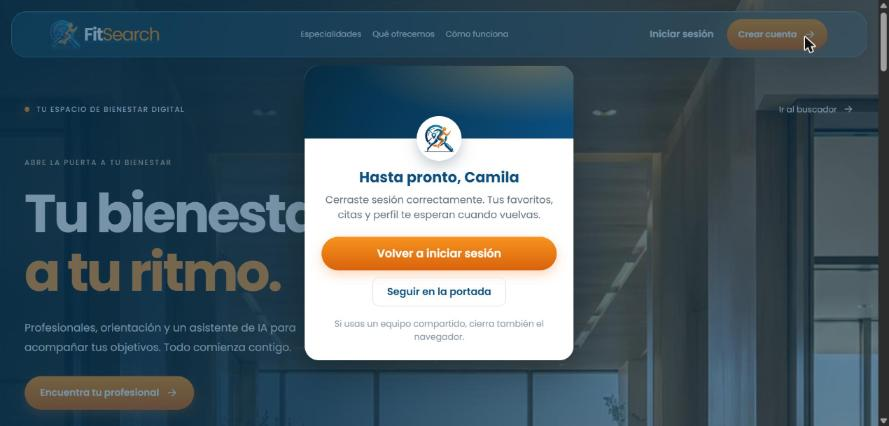
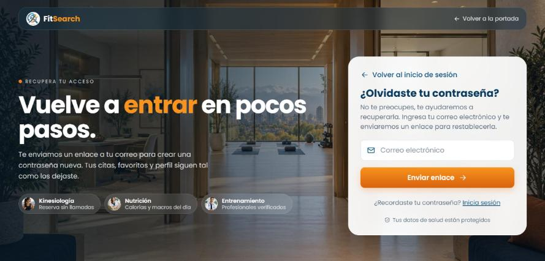
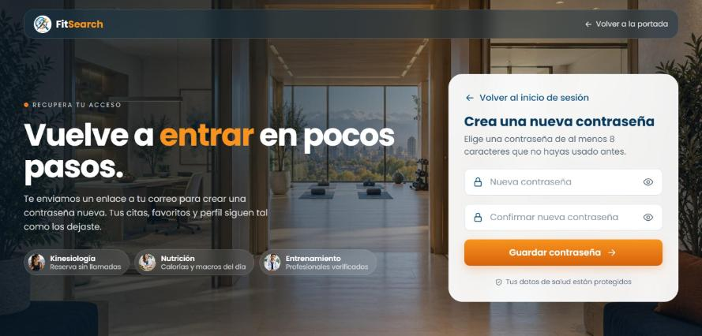
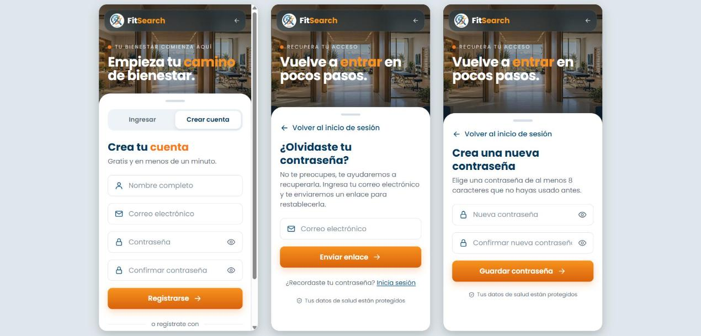

# Ajustes del nuevo login

Fecha: 03-11-2026. Rama `fix/ajustes-login`, sobre `946a7c8` (PR #37 fusionado). Son los 4 ajustes del nuevo login que pidió Rodrigo Cárcamo al revisar el PR #36, planificados en el Sprint Backlog 5 («Pendientes del Sprint 4»). Falta la aceptación del PO.

## Comportamiento

1. **Despedida accesible:** mientras está abierta, el resto de la portada queda inerte (`inert`). Así, con Tab no se llega a la portada de atrás y el lector de pantalla no la lee. Al cerrarla con «Seguir en la portada» o con Escape, el foco vuelve a `#contenido` en vez de quedar en el `body`.
2. **Textos propios de las pantallas de acceso:**
   - **Crear cuenta:** «Empieza tu camino de bienestar».
   - **Recuperar y crear una contraseña nueva:** «Vuelve a entrar en pocos pasos».
   - **Inicio de sesión:** conserva «Vuelve a tu espacio de bienestar».
3. **«Nutrición»:** dice «Calorías y macros del día» en vez de «Planes a tu ritmo», porque el plan de alimentación todavía no existe (FS-HU-32).
4. **Marca en la despedida:** muestra el logo de FitSearch en vez de la foto de una persona, para que no parezca la foto de quien cerró sesión.

No requiere migraciones ni variables de entorno nuevas, y no cambia contratos de API ni el modelo de datos.

## Casos de prueba

| Caso | Historia | Qué se prueba | Resultado esperado | Cómo se ejecutó | Resultado |
|---|---|---|---|---|---|
| CP-152 | FS-HU-20 | Despedida accesible | Con la despedida abierta, el encabezado, el contenido y el pie de la portada quedan inertes. Al cerrarla, el foco vuelve a `#contenido` y se quita `inert`. | `Portada.test.jsx` y navegador | Aprobado |
| CP-153 | FS-HU-20 | Marca en la despedida | La despedida muestra el logo de FitSearch y no la foto de una persona | `Portada.test.jsx` y navegador | Aprobado |
| CP-154 | FS-HU-17 | Texto propio al crear cuenta | Muestra «Empieza tu camino de bienestar.» y no «Vuelve a tu…» | `Registro.test.jsx` y navegador | Aprobado |
| CP-155 | FS-HU-15 | Texto propio al recuperar la contraseña | Muestra «Vuelve a entrar en pocos pasos.» al pedir el enlace y al crear la contraseña nueva | `RecuperarContrasena.test.jsx` y navegador | Aprobado |
| CP-156 | FS-HU-01 | Especialidad «Nutrición» | Dice «Calorías y macros del día» y no «Planes a tu ritmo» | `Registro.test.jsx` y navegador | Aprobado |

## Validación

- **Frontend:** 308 pruebas en 37 archivos, todas aprobadas; ESLint y compilación de producción correctos. El backend no cambia.
- **Navegador:** se probó en el entorno de desarrollo con Node y MySQL 8.4 en Docker, con el registro, la recuperación, la contraseña nueva y la despedida, usando una cuenta temporal.
  - Con la despedida abierta quedaron inertes `a.portada__saltar`, `header`, `main` y `footer`, y el foco inicial quedó en «Volver a iniciar sesión».
  - Al cerrarla con Escape, el foco quedó en `main#contenido` y no quedó ningún elemento inerte.
  - A 360 px no hay desborde horizontal en el registro, la recuperación ni la contraseña nueva: el ancho del documento es igual al de la ventana.
- **Limpieza:** en el navegador no se escribieron contraseñas. La cuenta temporal se eliminó al terminar y no se modificaron cuentas existentes ni credenciales.

## Capturas

Despedida con la marca de FitSearch:

Crear cuenta con su propio texto:

¿Olvidaste tu contraseña?:

Crear la contraseña nueva:

Registro, recuperación y contraseña nueva en celular (360 px):

Los casos CP-152 a CP-156 siguen la numeración de los PR abiertos, que llegan hasta el CP-151. Se agregan a la Planilla de Casos de Prueba al consolidar la documentación después de la fusión. Estas comprobaciones no equivalen a la aceptación del PO.
