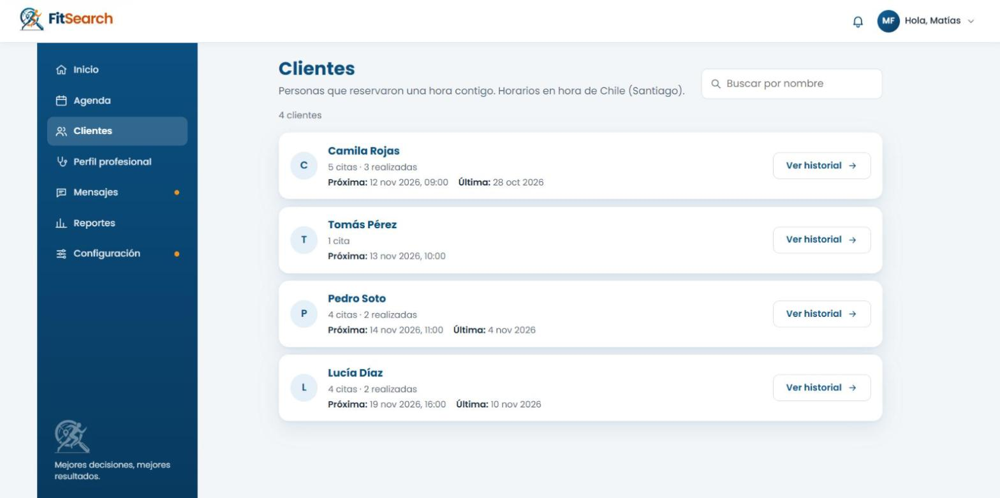
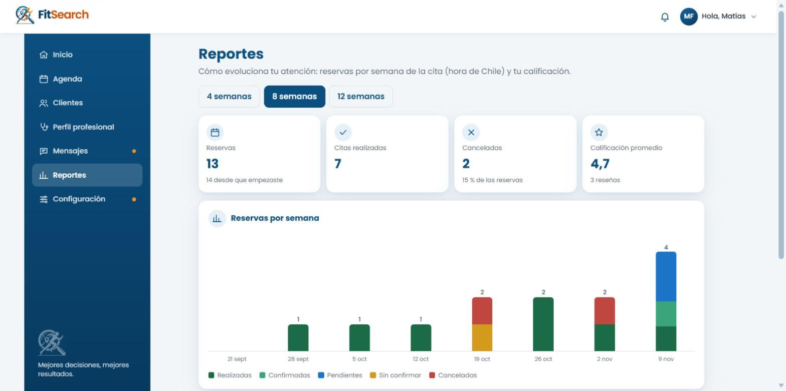
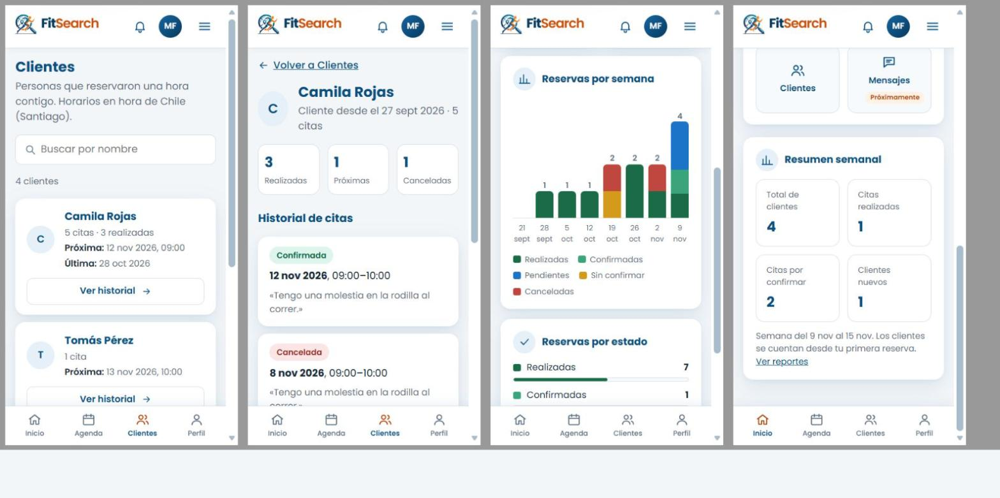

# Clientes y reportes del profesional (FS-HU-27 y FS-HU-28)

Fecha: 10 y 11-11-2026. Rama `feat/clientes-y-reportes`, sobre `0e45e88` (PR #46 fusionado). Historias del Sprint 5 (nivel 2, SC-32); aceptación del PO pendiente.

## Comportamiento

- **Clientes** (`/profesional/clientes`): lista de las personas que reservaron con el profesional, con la cantidad de citas, las realizadas, la próxima cita y la última. Primero quienes tienen una cita próxima (la más cercana arriba) y luego el resto por su última cita. Buscador por nombre que no distingue tildes ni mayúsculas.
- **Historial del cliente** (`/profesional/clientes/:id`): todas las citas de esa persona con el profesional, de la más reciente a la más antigua, con su estado, horario y el mensaje que dejó al reservar. Para confirmar o cancelar se sigue usando la Agenda.
- **Reportes** (`/profesional/reportes`): reservas, citas realizadas, canceladas y calificación promedio del período; gráfico de reservas por semana apiladas por estado (con tabla para lectores de pantalla); reservas por estado. Período de 4, 8 (por defecto) o 12 semanas.
- **Resumen semanal** del Inicio del profesional: total de clientes, citas realizadas en la semana, citas por confirmar y clientes nuevos de la semana. Ya no aparece como «Próximamente». Si hay citas por confirmar, también aparecen en «Tareas pendientes» con acceso a la Agenda; sin tareas, el panel dice «Estás al día» en vez de quedar vacío.
- Estados: una cita confirmada que ya comenzó (hora de Chile) se cuenta como **realizada**; una pendiente que pasó sin confirmarse, como **sin confirmar**. Las semanas van de lunes a domingo y se cuentan por la fecha de la cita.
- Privacidad: la API entrega solo el nombre de la persona y sus citas con ese profesional. No entrega correo ni la información de salud (FS-HU-19). Una persona que nunca reservó con el profesional responde 404, sin revelar si la cuenta existe.
- API nueva, solo para el rol profesional: `GET /api/profesional/clientes`, `GET /api/profesional/clientes/:id` y `GET /api/profesional/reportes?semanas=4..26`. Sin sesión responde 401; con otro rol, 403; sin ficha profesional, 409.
- No requiere migraciones ni nuevas variables de entorno.

## Casos de prueba

| Caso | Historia | Qué se prueba | Resultado esperado | Cómo se ejecutó | Resultado |
|---|---|---|---|---|---|
| CP-160 | FS-HU-27 | Lista de clientes | Cada persona con su cantidad de citas, próxima y última cita; sin correo ni datos de salud | `actividadProfesional.service.test.js`, `Clientes.test.jsx` y MySQL | Aprobado |
| CP-161 | FS-HU-27 | Buscar cliente | El filtro por nombre no distingue tildes ni mayúsculas e informa «N de M clientes» | `Clientes.test.jsx` | Aprobado |
| CP-162 | FS-HU-27 | Historial del cliente | Citas de la más reciente a la más antigua; una confirmada que ya pasó se muestra como «Realizada» | `actividadProfesional.service.test.js`, `Clientes.test.jsx` y MySQL | Aprobado |
| CP-163 | FS-HU-27 | Persona que no es cliente | 404 «No encontramos a esta persona entre tus clientes», sin datos | `actividadProfesional.service.test.js`, `Clientes.test.jsx` y MySQL | Aprobado |
| CP-164 | FS-HU-27 y FS-HU-28 | Permisos | Sin sesión 401; usuario y administrador 403; profesional sin ficha 409 con enlace a completarla | `actividadProfesional.api.test.js`, pruebas de pantalla y MySQL | Aprobado |
| CP-165 | FS-HU-27 | Sin clientes | Estado vacío «Aún no tienes clientes» con el botón «Publicar horario» | `Clientes.test.jsx` | Aprobado |
| CP-166 | FS-HU-28 | Reservas por semana y por estado | Semanas de lunes a domingo por la fecha de la cita, con pendientes, confirmadas, realizadas, sin confirmar y canceladas | `actividadProfesional.service.test.js`, `Reportes.test.jsx` y MySQL | Aprobado |
| CP-167 | FS-HU-28 | Calificación promedio | Promedio con un decimal y cantidad de reseñas; sin reseñas muestra «—» y «Aún sin reseñas» | `actividadProfesional.service.test.js`, `Reportes.test.jsx` y MySQL | Aprobado |
| CP-168 | FS-HU-28 | Período del reporte | Botones de 4, 8 y 12 semanas; la API acepta de 4 a 26 y responde 400 fuera de ese rango | `actividadProfesional.api.test.js` y `Reportes.test.jsx` | Aprobado |
| CP-169 | FS-HU-28 | Resumen semanal del Inicio | Muestra los cuatro valores de la semana en curso; si no carga, muestra «—» sin inventar datos. Las citas por confirmar aparecen como tarea con «Revisar» hacia la Agenda | `EspacioProfesional.test.jsx`, MySQL y navegador | Aprobado |

## Validación

- Backend: 366 pruebas en 37 archivos (Jest y Supertest), todas aprobadas; 12 son nuevas (7 del servicio y 5 de la API). ESLint sin errores.
- Frontend: 325 pruebas en 40 archivos (Vitest), todas aprobadas; 13 son nuevas o actualizadas (Clientes, Reportes y el Inicio del profesional). ESLint y compilación de producción correctos.
- En la primera ejecución falló una prueba propia («si la API falla, permite reintentar»): en modo de desarrollo React repite la primera consulta, y la simulación solo fallaba la primera llamada. Se ajustó para que la API falle hasta pulsar «Reintentar»; la carpeta del profesional quedó en 56 de 56.
- MySQL 8.4 real (en Docker, junto con la prueba de FS-HU-11): profesional con ficha y un horario, usuaria con una reserva pendiente. Clientes devolvió a la usuaria con 1 cita pendiente y su próxima cita; el historial, 1 cita con los campos `id, nombre, totalCitas, estados, proximaCita, ultimaCita, primeraReserva` (sin correo ni salud); un id ajeno, 404; Reportes de 4 semanas, `total 1, pendientes 1`, calificación `null` con 0 reseñas y resumen semanal con 1 cliente nuevo; la usuaria en Clientes, 403.
- Navegador (11-11-2026), con la API y MySQL 8.4 del entorno de desarrollo y datos temporales: un profesional con ficha, cuatro clientes con 14 citas (pasadas realizadas, sin confirmar y canceladas, y próximas pendientes y confirmadas) y tres reseñas. Clientes, el historial, Reportes y el Resumen semanal mostraron los valores esperados (13 reservas en 8 semanas, 7 realizadas, 2 canceladas, promedio 4,7 con 3 reseñas; semana del 9 al 15 de noviembre con 4 clientes, 1 cita realizada, 2 por confirmar y 1 cliente nuevo). Se revisó en 1568 px y en 370 px, sin desborde horizontal.
- Ajustes después de la revisión en el navegador: el buscador de Clientes ocupa todo el ancho en el celular; los cuadros del historial ya no se desbordan en 370 px; los botones de período de Reportes quedan en una fila; «Cliente desde» usa la fecha en hora de Chile; el panel «Tareas pendientes» muestra las citas por confirmar o «Estás al día».
- Las cuentas temporales (`@example.test`) se eliminaron al terminar cada prueba (en Docker con `docker compose down -v`; en el entorno de desarrollo, borrando las cuentas `revision.*@example.test`). No se usaron cuentas reales ni se escribieron contraseñas en el navegador.

## Capturas

Clientes (1568 px):

Reportes (1568 px):

Clientes, historial, Reportes y Resumen semanal en celular (370 px):

Los casos CP-160 a CP-169 usan una numeración provisional después de los casos del Plan de Pruebas 1.0.1 (hasta CP-157). Se registraron en la Planilla de Casos de Prueba el 13-11-2026, después de la fusión del PR #50, y los criterios de aceptación de FS-HU-27 y FS-HU-28 se ampliaron a 5 escenarios cada uno. Estas comprobaciones no equivalen a aceptación del PO.
