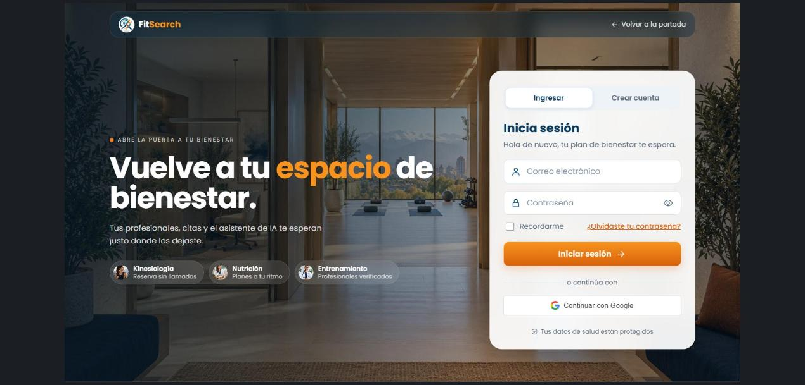
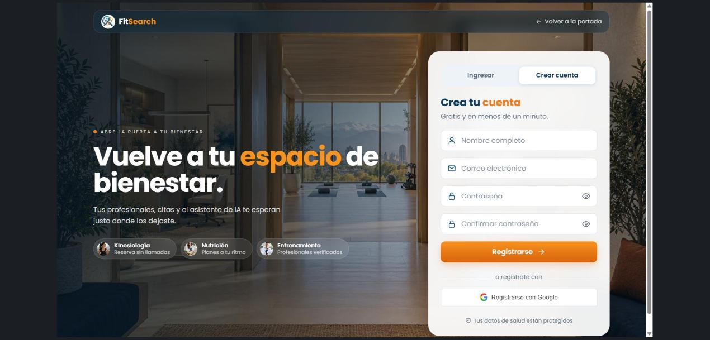
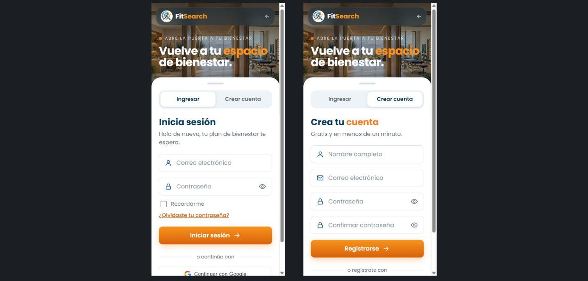
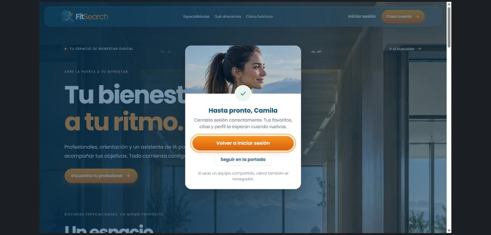

# Nuevo login: pantallas de acceso rediseñadas

Fecha: 28-10-2026. Rama `feat/nuevo-login` (PR #36), sobre `798a9fa` (PR #33 fusionado). Cambio de presentación para FS-HU-01, FS-HU-17 y FS-HU-20; aceptación del PO pendiente.

## Comportamiento

- Inicio de sesión, registro y recuperación de contraseña usan el estilo de la portada rediseñada: la foto del centro de bienestar de fondo, la barra flotante translúcida, la presentación con especialidades y el formulario en una tarjeta. En el celular la foto queda arriba y la tarjeta sube como hoja.
- Pestañas «Ingresar» y «Crear cuenta» en inicio de sesión y registro; reemplazan los enlaces del pie del formulario.
- Registro: indicador de seguridad de la contraseña (débil, media o fuerte, con sus requisitos) y aviso cuando ambas contraseñas coinciden. El largo mínimo sigue validándose también en el backend (`shared/reglas.json`).
- Campos de contraseña: aviso cuando Bloq Mayús está activado.
- Botones de envío: indicador de carga («Ingresando…», «Creando cuenta…»).
- Cierre de sesión: diálogo de despedida «Hasta pronto, {nombre}» sobre la portada, con «Volver a iniciar sesión» (recibe el foco) y «Seguir en la portada»; también se cierra con Escape.
- No requiere migraciones ni nuevas variables de entorno. No cambia contratos de API ni el modelo de datos.

## Casos de prueba

| Caso | Historia | Qué se prueba | Resultado esperado | Cómo se ejecutó | Resultado |
|---|---|---|---|---|---|
| CP-131 | FS-HU-01 | Pestañas de acceso | «Ingresar» marcada en inicio de sesión; «Crear cuenta» lleva al registro y queda marcada | `InicioSesion.test.jsx` y navegador | Aprobado |
| CP-132 | FS-HU-17 | Seguridad de la contraseña al registrarse | Muestra débil, media o fuerte y los requisitos cumplidos o pendientes | `IndicadorContrasena.test.jsx` y `Registro.test.jsx` | Aprobado |
| CP-133 | FS-HU-17 | Coincidencia de contraseñas | «Las contraseñas coinciden» solo cuando la confirmación es igual; con contraseñas distintas no se envía el registro | `Registro.test.jsx` | Aprobado |
| CP-134 | FS-HU-01 | Aviso de Bloq Mayús | Con Bloq Mayús activado en un campo de contraseña aparece el aviso; al salir del campo desaparece | `CampoFormulario.test.jsx` | Aprobado |
| CP-135 | FS-HU-20 | Despedida al cerrar sesión | Diálogo «Hasta pronto, {nombre}» sobre la portada, con el foco en «Volver a iniciar sesión» | `Portada.test.jsx` y navegador | Aprobado |
| CP-136 | FS-HU-20 | Cerrar la despedida | «Seguir en la portada» y Escape cierran el diálogo | `Portada.test.jsx` | Aprobado |
| CP-137 | FS-HU-01 | Diseño en computador (1366 × 768) | Presentación a la izquierda y tarjeta a la derecha, sin cortes | Navegador | Aprobado |
| CP-138 | FS-HU-01 | Diseño en celular (360 px) | Foto arriba, tarjeta como hoja y sin desborde horizontal | Navegador | Aprobado |

## Validación

- Frontend: 294 pruebas en 36 archivos, todas aprobadas. ESLint y compilación de producción correctos.
- Al integrar con la portada rediseñada falló una prueba de `Portada.test.jsx` que todavía esperaba el título antiguo «¡Bienvenido!» del inicio de sesión; se actualizó a «Inicia sesión», igual que el resto de las pruebas del acceso.
- Navegador con API y MySQL 8.4 locales: inicio de sesión y registro en 1366 × 768 y en 360 px (ancho del documento igual al de la ventana, sin desborde horizontal), cambio entre pestañas y despedida con una cuenta temporal.
- Bloq Mayús, la seguridad de la contraseña y la coincidencia se comprobaron con las pruebas automatizadas; en el navegador no se escribieron contraseñas.
- La cuenta temporal se eliminó al terminar. No se modificaron cuentas existentes ni credenciales.

## Capturas

Inicio de sesión (1366 × 768):

Registro (1366 × 768):

Inicio de sesión y registro en celular (360 px):

Despedida al cerrar sesión (1366 × 768):

Los casos CP-131 a CP-138 continúan la numeración del PR #34 (CP-126 a CP-130) y se agregan a la Planilla de Casos de Prueba al consolidar la documentación después de la fusión del PR. Estas comprobaciones no equivalen a aceptación del PO.
