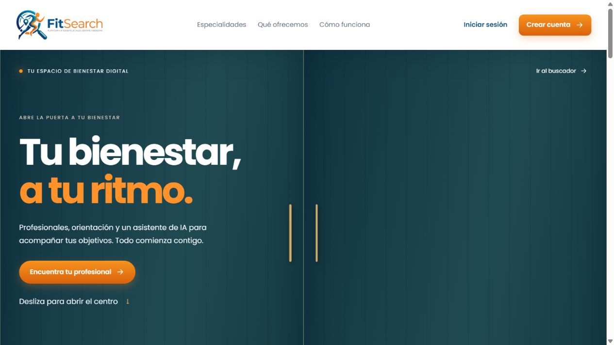
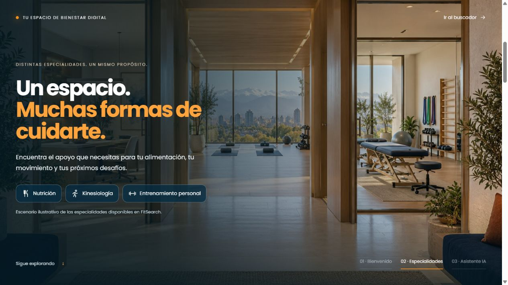
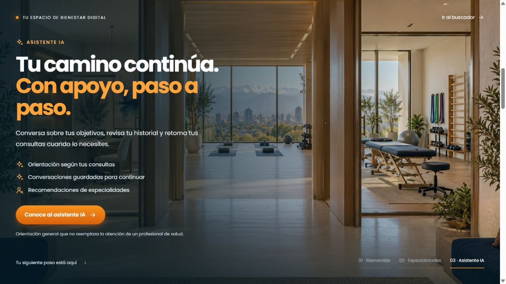
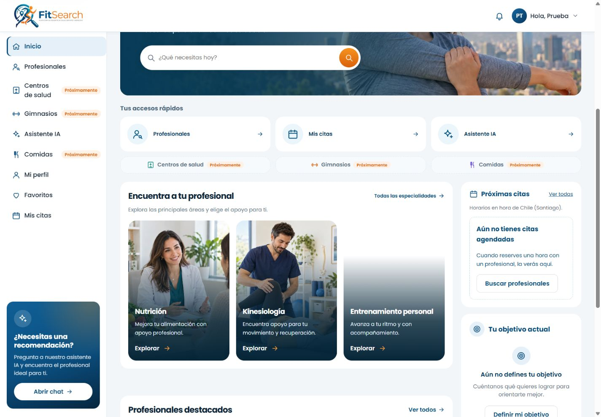
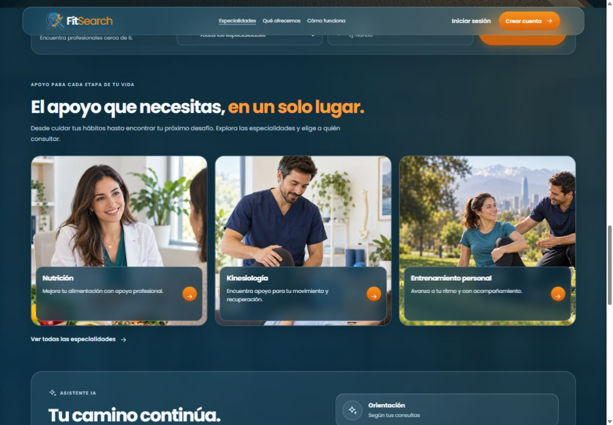
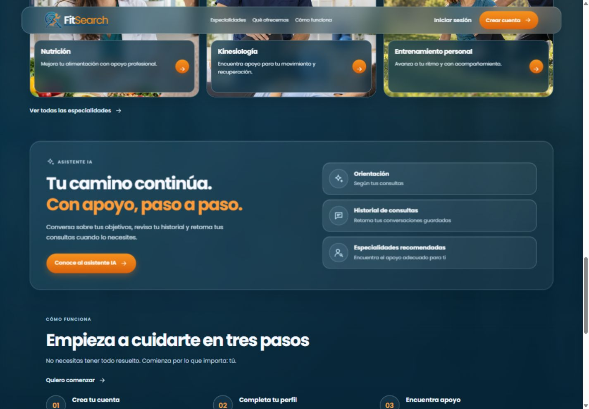
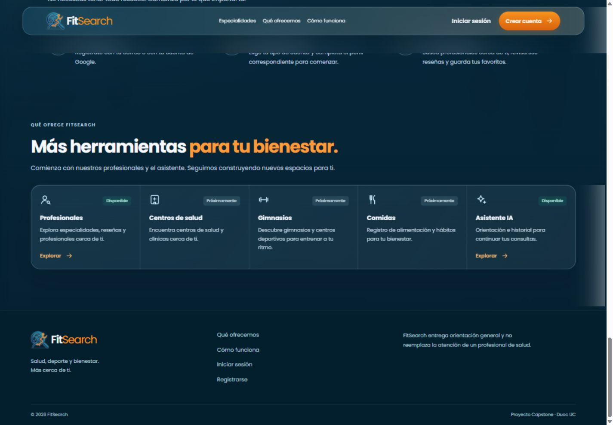

# Rediseño de portada e Inicio

Fecha: 25-10-2026. Base: `fb6dbbd` (PR #32 fusionado). Cambio de presentación para FS-HU-20 y FS-HU-21 a partir de los dos conceptos aprobados por Luis; aceptación final del PO pendiente.

## Comportamiento

- Portada pública con fotografías, especialidades, información de servicios y acceso al registro e ingreso. La búsqueda conserva especialidad y comuna al pasar por el inicio de sesión.
- Inicio del usuario con saludo, buscador general, accesos a profesionales, citas y asistente, tarjetas de especialidades y profesionales destacados. Perfil, objetivos, estimación de calorías, citas y favoritos siguen usando los componentes y datos existentes.
- Centros de salud, gimnasios, comidas y métricas todavía no implementadas mantienen sus avisos de Próximamente. El asistente disponible se anuncia como tal.
- Fotografías ilustrativas locales optimizadas en WebP (aproximadamente 392 KB en total); procedencia documentada en `frontend/src/assets/inicio/README.md`. No se presentan como profesionales registrados ni testimonios.
- No requiere migraciones ni nuevas variables de entorno. No cambia contratos de API ni el modelo de datos. La arquitectura de los diagramas vigentes se mantiene.

## Validación

- Frontend: 285 pruebas en 34 archivos, todas aprobadas. Incluyen conservación de filtros tras el ingreso, acceso desde tarjetas de especialidades y regresión de roles, favoritos, citas, perfil y sugerencias por teclado.
- ESLint y compilación de producción correctos.
- Navegador con API y MySQL locales: búsqueda Nutrición/Ñuñoa desde portada, ingreso con cuenta temporal y filtros conservados en el directorio; Inicio con destacados reales, estados vacíos del perfil y citas, sugerencias del buscador y cierre de sesión.
- Revisión visual en 1440, 390 y 320 px. Sin desborde horizontal en ambas vistas; ajuste flexible del logo del encabezado para la pantalla de 320 px. Se preservan menú móvil, navegación inferior y estilos de foco.
- La cuenta temporal se eliminó al terminar. No se modificaron cuentas existentes ni credenciales.

## Efectos al desplazarse

Se agregan apariciones de una sola vez al entrar los bloques en pantalla, con entrada escalonada de las tarjetas de especialidades y herramientas. Las fotografías principales tienen un desplazamiento máximo de 18 px ligado al scroll, sin alterar la posición de la página ni los enlaces.

La preferencia de movimiento reducido desactiva los efectos, incluso si cambia con la página abierta. El foco sobre un control cancela la animación de su bloque. Sin las APIs de animación, el contenido permanece visible. Se limpian observadores, cuadros y escuchas al salir de la vista. No se agregan dependencias.

Las tres pruebas específicas cubren la animación única, el acceso por foco, el movimiento reducido y su cambio en tiempo real, además de la limpieza al desmontar. Se comprobó en navegador el desplazamiento de la portada y la lectura de las secciones posteriores. Las capturas estáticas muestran la composición final; el movimiento se aprecia al recorrer la página.

## Recorrido inmersivo del centro de bienestar · 26-10-2026

La portada usa ahora una escena fija durante el recorrido, con puertas en perspectiva que se abren conforme baja la página. La imagen del interior se acerca y aparecen tres momentos: bienvenida, especialidades y asistente IA. Al subir se recorre la secuencia en sentido inverso. El acceso «Ir al buscador» permite omitirla.

La escena es ilustrativa del espacio digital; no representa un establecimiento afiliado. La imagen nueva se genera para este proyecto y pesa 315 KB en WebP. El mensaje del asistente se limita a capacidades existentes: orientación a partir de las consultas, conversaciones guardadas y recomendaciones de especialidades. No afirma seguimiento clínico ni recordatorios automáticos. El Inicio con sesión también destaca la posibilidad de retomar consultas.

Con movimiento reducido o altura de pantalla de 600 px o menos, el relato se presenta en flujo normal, con todos sus enlaces disponibles. En el modo animado, los capítulos inactivos quedan fuera del foco mediante inert y aria-hidden. Las tres pruebas específicas del hero cubren avance y retroceso, destinos de enlaces, acceso sin animación y cambio de preferencia/limpieza. Se mantienen las pruebas de búsqueda e ingreso con filtros.

Revisión en navegador: capítulos de especialidades e IA, enlace directo al buscador, anchuras de 390 y 320 px sin desborde, y alternativa estática a 900 × 500 px. La suite final tiene 285 pruebas en 34 archivos; lint y build correctos. No hay cambios en los contratos de API, la base de datos ni las funciones del asistente.

## Capturas del recorrido inmersivo

Entrada:

Especialidades:

Asistente IA:

Inicio con cuenta temporal y datos reales de la API (composición general del rediseño):

La publicación en main y cualquier sincronización de documentación compartida quedan sujetas a la revisión y fusión del PR. Estas comprobaciones no equivalen a aceptación del PO.

## Estilo translúcido de la portada · 26-10-2026

Se implementa la propuesta de vidrio para evaluación visual: fondo azul continuo, encabezado flotante fijo con transparencia y desenfoque, buscador de vidrio, tarjetas de especialidades con fotografía completa y texto sobre un panel translúcido, bloque destacado de IA y franja de herramientas. La identidad usa el símbolo existente con el nombre FitSearch adaptado al fondo oscuro. El estilo queda limitado a la portada pública; el Inicio con sesión conserva su presentación.

Se mantiene la escena de puertas y su alternativa estática, la búsqueda por especialidad/comuna, el registro, el ingreso, los enlaces filtrados y la protección de acceso al asistente. El nuevo bloque de IA enlaza al asistente real. Las tres herramientas futuras conservan Próximamente y no incorporan acciones simuladas. No se agregan imágenes generadas, dependencias, datos ficticios ni cambios en la API.

Validación: 285 pruebas frontend aprobadas; lint y build correctos. Revisión del encabezado persistente, tarjetas, pasos y herramientas en escritorio; pantallas de 390 y 320 px sin desborde horizontal; menú de dos filas a 320 px; enlace del asistente redirige al ingreso. Los anclajes dejan espacio para el encabezado. Hay superficies opacas de respaldo cuando el dispositivo solicita reducir transparencias.

La propuesta sigue pendiente de evaluación visual del usuario y aceptación del PO.

