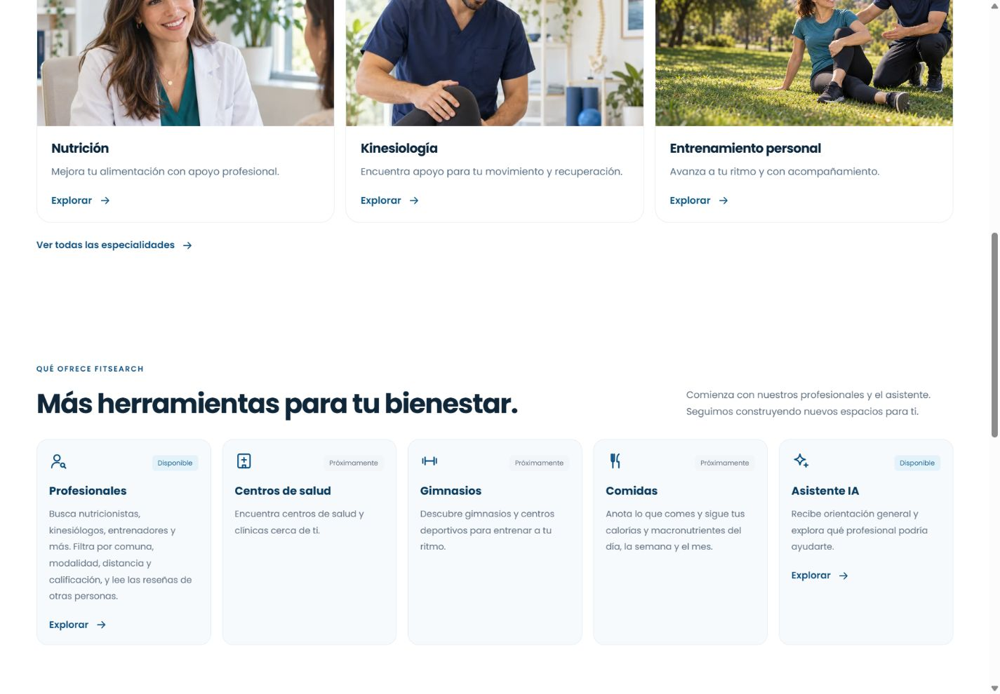

# Rediseño de portada e Inicio

Fecha: 25-10-2026. Base: `fb6dbbd` (PR #32 fusionado). Cambio de presentación para FS-HU-20 y FS-HU-21 a partir de los dos conceptos aprobados por Luis; aceptación final del PO pendiente.

## Comportamiento

- Portada pública con fotografías, especialidades, información de servicios y acceso al registro e ingreso. La búsqueda conserva especialidad y comuna al pasar por el inicio de sesión.
- Inicio del usuario con saludo, buscador general, accesos a profesionales, citas y asistente, tarjetas de especialidades y profesionales destacados. Perfil, objetivos, estimación de calorías, citas y favoritos siguen usando los componentes y datos existentes.
- Centros de salud, gimnasios, comidas y métricas todavía no implementadas mantienen sus avisos de Próximamente. El asistente disponible se anuncia como tal.
- Fotografías ilustrativas locales optimizadas en WebP (aproximadamente 392 KB en total); procedencia documentada en `frontend/src/assets/inicio/README.md`. No se presentan como profesionales registrados ni testimonios.
- No requiere migraciones ni nuevas variables de entorno. No cambia contratos de API ni el modelo de datos. La arquitectura de los diagramas vigentes se mantiene.

## Validación

- Frontend: 279 pruebas en 32 archivos, todas aprobadas. Incluyen conservación de filtros tras el ingreso, acceso desde tarjetas de especialidades y regresión de roles, favoritos, citas, perfil y sugerencias por teclado.
- ESLint y compilación de producción correctos.
- Navegador con API y MySQL locales: búsqueda Nutrición/Ñuñoa desde portada, ingreso con cuenta temporal y filtros conservados en el directorio; Inicio con destacados reales, estados vacíos del perfil y citas, sugerencias del buscador y cierre de sesión.
- Revisión visual en 1440, 390 y 320 px. Sin desborde horizontal en ambas vistas; ajuste flexible del logo del encabezado para la pantalla de 320 px. Se preservan menú móvil, navegación inferior y estilos de foco.
- La cuenta temporal se eliminó al terminar. No se modificaron cuentas existentes ni credenciales.

## Capturas

Portada pública:

Inicio con cuenta temporal y datos reales de la API:

La publicación en main y cualquier sincronización de documentación compartida quedan sujetas a la revisión y fusión del PR. Estas comprobaciones no equivalen a aceptación del PO.
